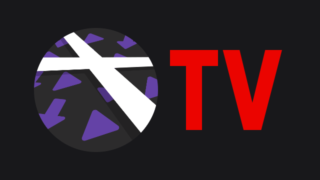

<p align="center">
  
</p>

# Xtra TV

Xtra TV is an Android TV interface for [Xtra](https://github.com/crackededed/Xtra), the open source Twitch player and browser for Android. It keeps everything Xtra does (player, chat, ad-blocking proxies, login, settings) and adds a home screen made for the TV and the remote control: no touch screen, no tiny buttons, everything reachable with the arrow keys and OK.

## Download

**[Download the latest APK](https://github.com/MrKubb/Xtra-TV/releases/latest/download/Xtra-TV.apk)**, or browse all the [releases](https://github.com/MrKubb/Xtra-TV/releases).

The APK installs next to the official Xtra app (it uses its own package name), so both can be kept on the same device.

## Features

### Home screen
- One horizontal row per section, stacked vertically, with big 16:9 cards.
- The sidebar works as an index: moving up and down in it scrolls the home screen to the matching row, no click needed. Moving through the rows highlights the matching sidebar entry.
- Counters next to the sections once their lists are loaded, e.g. "Followed live (13)".
- Selecting a game or a channel opens its full list; Back returns to the exact card you came from.

### Sections
| Section | Content |
|---|---|
| Followed live | Live channels you follow |
| Favorites | Channels you pinned, live ones first |
| My games live | One row per followed game, with its live streams |
| Language rows | One row per language you pick, e.g. French or English streams |
| Suggestions | Channels similar to the last one you watched |
| Past broadcasts | Latest videos of the channels you follow |
| Followed channels | All the channels you follow |
| Followed games | Box art of the games you follow (hidden by default) |
| Top games / Top streams | What is popular right now, optionally filtered by language |

Every section can be shown, hidden and moved in **Settings → Menu sections**.

### Watching
- **Live preview**: leave the focus on a stream for a second and it starts playing inside its card, with sound. It goes through the same ad-blocking proxies as the player. Can be turned off.
- **Full screen by default**: streams open without the chat, which can still be opened from the player.
- **Favorites**: hold OK on a stream or a channel to add it to (or remove it from) your favorites, or to open the channel.
- **Search** for streams, channels and games.

### Login and settings
- **Login with an activation code**: the TV shows a code to enter on [twitch.tv/activate](https://www.twitch.tv/activate) from a phone or a computer, no typing with the remote. Xtra's regular browser login is still available as a fallback.
- **Remote-friendly settings**: start section, menu sections, language rows, card size, video preview, app language, default quality, ads, chat options.
- All of Xtra's settings and its original interface remain one click away under **Settings → Advanced**.
- The app opens on the TV interface by default on TVs (can be turned off).

## Installation

On an Android TV / Google TV device:

1. **With a USB stick**: copy the APK, plug the stick into the TV, open the APK with a file manager (for example *File Commander* or *X-plore*) and allow the installation when asked.
2. **With ADB from a computer**: enable developer options on the TV (Settings → System → About, press *Build* 7 times), enable USB or network debugging, then run:
   ```
   adb connect <TV-IP>:5555
   adb install -r Xtra-TV.apk
   ```

Xtra TV then shows up in the TV's apps with its banner.

## Remote control

| Key | Action |
|---|---|
| Up / Down in the sidebar | Jump to a section |
| Right | Enter the section |
| Left / Right / Up / Down | Move between cards and rows |
| OK | Play the stream, open the game or the channel |
| Hold OK | Favorites menu |
| Back | Back to the previous page, then to the sidebar |

## Building from source

```
./gradlew assembleDebug
```

The APK is written to `app/build/outputs/apk/debug/`. The TV interface lives in `app/src/main/java/com/github/andreyasadchy/xtra/ui/tv/` and in the `tv_*` resources; the rest is Xtra, kept unchanged so the `tv` branch can be rebased on new Xtra versions.

## Credits and license

Xtra TV is based on [Xtra](https://github.com/crackededed/Xtra) by crackededed, itself a continuation of [Xtra](https://github.com/AndreyAsadchy/Xtra) by Andrey Asadchy. All the credit for the player, the chat and the Twitch integration goes to them.

Like Xtra, Xtra TV is licensed under the [GNU Affero General Public License v3.0](LICENSE).

## Disclaimer

The Android TV interface of this fork was made entirely with the help of AI.
